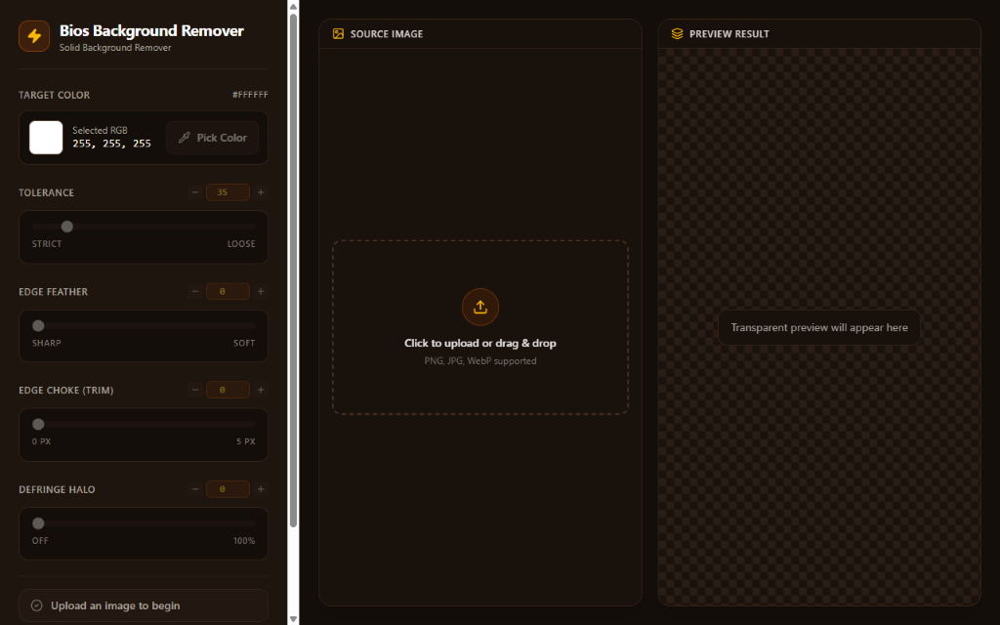

# Bios Background Remover

<a href="https://thatbio.vercel.app/tools/background-remover/"></a>

A client-side React + Tailwind CSS tool for removing solid-color backgrounds from portraits and illustrations with fine-tuned tolerance, edge choke, defringe halo cleanup, edge feathering, and independent source/preview zoom.



## Features

- **100% Client-Side Processing**: Uses the HTML5 Canvas API—your images never leave your computer. (The hosted version counts anonymous page views with Vercel Web Analytics, without cookies; running it locally doesn't.)
- **Auto-Sample & Eyedropper**: Automatically samples the top-left pixel `(0, 0)` on upload, with a **Pick Color** eyedropper for sampling any pixel.
- **Fine-Grained Controls**:
  - **Tolerance (`0–255`, `0.5` step)**: Euclidean RGB color distance matching.
  - **Edge Choke (`0–5 px`, `0.5 px` step)**: Trims the outer anti-aliased fringe inward without making the subject transparent.
  - **Defringe Halo (`0–100%`)**: Decontaminates remaining edge pixels by blending nearby interior foreground colors.
  - **Edge Feather (`0–60`, `0.5` step)**: Smoothly softens transitions.
- **Independent Source & Preview Zoom (`100%–600%`)**: Zoom and pan Source and Preview independently to inspect fine portrait details like hair and edges.
- **Native Save As Export**: Opens a native Windows Save As dialog when running locally via Vite (works in Brave, Firefox, Chrome, and Edge), with automatic browser download fallback.

## Quick Start (Windows)

1. Double-click **`Install Dependencies.bat`** (automatically installs Node.js LTS via `winget` if needed, then runs `npm install`).
2. Double-click **`Start Background Remover.bat`** to start the local server and open the app in your browser.

**Updates:** each time you start it, the start script checks GitHub for a newer version and asks *Update now? [Y,N]* (it says yes on its own after 15 seconds). A cloned copy is updated with `git pull` (skipped if you changed files yourself); a downloaded zip copy gets the latest files from GitHub copied over it. Your images are never touched. To skip the check, set the environment variable `NO_UPDATE_CHECK=1`. Copies from before this updater existed need one manual update first.

## Manual Setup

```bash
npm install
npm run dev
```

## Tech Stack

- React 18
- Vite 6
- Tailwind CSS 4
- Lucide React

## License

Copyright © 2026 thatBiologyStudent. Licensed under the [GNU Affero General Public License v3.0](https://www.gnu.org/licenses/agpl-3.0.html) (AGPL-3.0). The full text is in [LICENSE](LICENSE).

You may use, change and share this project, also commercially. If you distribute it or a modified version (for example as a download or a desktop app), or run a modified version as a website or online service, you must release your full source code under the same license and keep the copyright notices.
